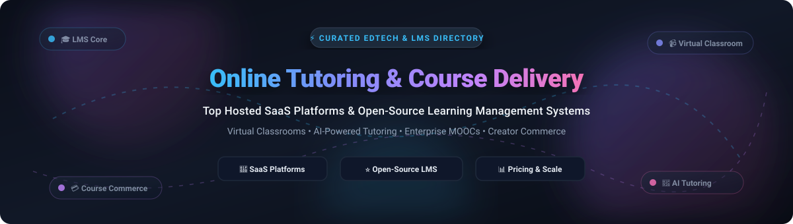

  

# 🎓 Awesome Online Tutoring & Course Delivery Platforms 🚀

  
  
  
  
  

> 💡 A curated list of top **Online Tutoring**, **Virtual Classroom**, and **Course Delivery** platforms — featuring SaaS creator platforms, open-source Learning Management Systems (LMS), and developer tools for building, delivering, and monetizing digital education experiences. 🌟
>
> 🌟 **Star this repository if you find it valuable!** 🌟

---

## 🔍 Overview & SEO Highlights 🎯

Whether you are launching an online tutoring business, scaling digital academies, or self-hosting open-source educational software, this directory aggregates:
* 💼 **Hosted & Commercial Course Creation Software (SaaS)** with verified pricing, free trial limits, and company scale.
* 💻 **Open-Source Learning Management Systems (LMS)** and virtual classrooms with live star badges, technology stacks, and deployment guides.
* 📊 **Market Insights** detailing EdTech sector dynamics, market size, and fragmentation trends.

---

## 📋 Table of Contents 📑

- [📈 Sector Overview & Market Dynamics](#-sector-overview--market-dynamics-)
- [🟦 SaaS / Hosted Platforms](#-saas--hosted-platforms-)
- [🟩 Open-Source Software](#-open-source-software-)
  - [📹 BigBlueButton](#-bigbluebutton)
  - [🏛️ Open edX](#%EF%B8%8F-open-edx)
  - [🎒 Moodle](#-moodle)
  - [💬 Oppia](#-oppia)
  - [🏫 Canvas LMS](#-canvas-lms)
  - [⚡ Frappe LMS](#-frappe-lms)
  - [🧱 LearnHouse](#-learnhouse)
  - [🌐 Chamilo LMS](#-chamilo-lms)
  - [🎯 Pupilfirst](#-pupilfirst)
  - [🎥 Opencast](#-opencast)
  - [🛡️ ILIAS](#%EF%B8%8F-ilias)
  - [📝 LiaScript](#-liascript)
  - [🧠 Scibly](#-scibly)
  - [💳 Euron Open LMS](#-euron-open-lms)
  - [📺 VibeLMS](#-vibelms)
- [📊 Feature Comparison Matrix](#-feature-comparison-matrix-)
- [🤝 Contributing](#-contributing-)
- [💖 Support & Sponsorship](#-support--sponsorship-)
- [⭐ Star History](#-star-history)
- [📄 License](#-license-)

---

## 📈 Sector Overview & Market Dynamics 🌐

The global online tutoring and digital course delivery market is estimated between **$11 billion and $13 billion** (with broader EdTech and learning management infrastructure exceeding **$18 billion to $36 billion**), growing at a **CAGR of ~12.5% to 15.6%**. 🚀

The sector is **moderately fragmented** rather than a winner-take-all monopoly: while a handful of well-capitalized platforms command mindshare in creator commerce (e.g., Kajabi, Teachable) and higher education (e.g., Canvas, Moodle), low barriers to entry and distinct vertical specializations (K-12 supplemental tutoring, language learning, corporate upskilling, and private cohort academies) allow diverse hosted solutions and open-source alternatives to thrive. 🧩

---

## 🟦 SaaS / Hosted Platforms ☁️

Cloud-hosted commercial platforms for online course delivery, digital coaching, tutoring storefronts, and knowledge commerce. Sorted by company scale (valuation / annual revenue descending). 🏆

| Platform | Valuation / Revenue Scale 💰 | Starting Pricing 🏷️ | Free Tier / Free Trial Limits ⏳ | Key Specialization 🎯 |
| :--- | :--- | :--- | :--- | :--- |
| **[Kajabi](https://kajabi.com/)** | **~$2.0 Billion valuation** (~$10B+ GMV generated by creators) | **$179/mo** (or $143/mo billed annually) for Basic tier | **14-day free trial** (up to 3 products, 1 website, 1 community, up to 10k contacts; 0% transaction fee; 30-day money-back guarantee) | 🛠️ All-in-one knowledge commerce, integrated funnel builder & email marketing automation |
| **[Teachable](https://teachable.com/)** | **~$250 Million acquisition valuation** (Subsidiary of Hotmart, ~$26M+ ARR at acquisition) | **$39/mo** (or $29/mo billed annually) + 7.5% transaction fee for Starter tier | **7-day free trial** of paid tiers (test core course-builder features and storefront templates; permanent free plan retired) | 🎨 Creator-friendly course authoring, student checkout, and integrated tax/payment handling |
| **[Thinkific](https://www.thinkific.com/)** | **~$100 Million market cap / ~$75M ARR** (Publicly traded: TSX: THNC) | **$109/mo** (or $82/mo billed annually) for Start tier | **30-day free trial** (unlimited courses, up to 10k active learners, 2 admin accounts, interactive quizzes; permanent free plan retired) | 🏪 Customizable storefronts, student community spaces, and native course authoring |
| **[LearnWorlds](https://www.learnworlds.com/)** | **~$25M+ ARR** (Privately held, scaled mid-market EdTech) | **$29/mo** (or $24/mo billed annually) + $5 per enrollment for Starter tier | **30-day free trial** (no credit card required; full access to chosen tier features like course builder and interactive testing) | 🎬 Interactive video branching, learner assessments, white-label mobile apps, and SCORM support |
| **[Podia](https://www.podia.com/)** | **~$10M+ ARR** (Bootstrapped / privately held creator platform) | **$49/mo** (or $42/mo billed annually) + 5% transaction fee for Mover tier | **14-day free trial** (no credit card required; full builder access, up to 100 email subscribers, digital downloads & courses preview) | 📦 All-in-one digital downloads, lightweight coaching, courses, and community spaces |

---

## 🟩 Open-Source Software 🔓

Self-hosted, community-driven online tutoring environments, virtual classrooms, and LMS solutions. Sorted in descending order by GitHub stargazers. ⭐

| Project | Stars ⭐ | Stack 🛠️ | License 📜 | Description 📝 |
| :--- | :--- | :--- | :--- | :--- |
| **[BigBlueButton](#-bigbluebutton)** |  | Scala / Java / Node.js / HTML5 | LGPL-3.0 | 📹 Real-time web conferencing system designed specifically for online tutoring and virtual classrooms. |
| **[Open edX](#%EF%B8%8F-open-edx)** |  | Python / Django / React | AGPL-3.0 | 🏛️ Battle-tested, enterprise-grade MOOC and course delivery engine originally developed by MIT and Harvard. |
| **[Moodle](#-moodle)** |  | PHP / MySQL / PostgreSQL | GPL-3.0 | 🎒 The world's most widely deployed modular open-source Learning Management System. |
| **[Oppia](#-oppia)** |  | Python / Angular / TypeScript | Apache-2.0 | 💬 Interactive, conversational tutoring platform that teaches through exploratory guided lessons. |
| **[Canvas LMS](#-canvas-lms)** |  | Ruby on Rails / React / PostgreSQL | AGPL-3.0 | 🏫 Open-source core of the modern LMS powering leading global universities and school districts. |
| **[Frappe LMS](#-frappe-lms)** |  | Python / Frappe Framework / Vue.js | AGPL-3.0 | ⚡ 100% open-source modern LMS with course builder, discussion boards, quizzes, and certification tracking. |
| **[LearnHouse](#-learnhouse)** |  | Next.js / FastAPI / PostgreSQL | AGPL-3.0 | 🧱 Notion-like block-based learning platform with live coding playgrounds, collaborative whiteboards, and AI exercises. |
| **[Chamilo LMS](#-chamilo-lms)** |  | PHP / Symfony / MySQL | GPL-3.0 | 🌐 Intuitive, e-learning and training management system emphasizing accessibility and simple course authoring. |
| **[Pupilfirst](#-pupilfirst)** |  | Ruby on Rails / React / PostgreSQL | Apache-2.0 | 🎯 Asynchronous school engine driven by student milestone submissions, direct tutor reviews, and iterative feedback. |
| **[Opencast](#-opencast)** |  | Java / OSGi / JavaScript | ECL-2.0 | 🎥 Open-source lecture recording, video processing, and academic video delivery management system. |
| **[ILIAS](#%EF%B8%8F-ilias)** |  | PHP / MariaDB | GPL-3.0 | 🛡️ Comprehensive SCORM-certified learning management system developed for German higher education and defense. |
| **[LiaScript](#-liascript)** |  | JavaScript / Elm / Markdown | BSD-3-Clause | 📝 Markdown compiler turning simple text files into interactive web-based educational courses and quizzes. |
| **[Scibly](#-scibly)** |  | Next.js / TypeScript / PostgreSQL | AGPL-3.0 | 🧠 AI-native learning platform turning internal documentation, PDFs, and notes into interactive microlearning courses. |
| **[Euron Open LMS](#-euron-open-lms)** |  | TypeScript / Node.js / PostgreSQL | Open Source | 💳 Full-lifecycle LMS with HLS video classrooms, verifiable certificates, Stripe/Razorpay commerce, and mobile apps. |
| **[VibeLMS](#-vibelms)** |  | React / Node.js / Drizzle / PostgreSQL | Open Source | 📺 Lightweight LMS with YouTube video integration, TipTap rich text editing, and anonymous learner progress tracking. |

---

### Detailed Open-Source Project Profiles 📖

#### 📹 BigBlueButton
* **GitHub Repository:** [bigbluebutton/bigbluebutton](https://github.com/bigbluebutton/bigbluebutton)
* **Stack:** Scala / Java / Node.js / HTML5 | **License:** LGPL-3.0
* **Overview:** BigBlueButton is an open-source virtual classroom platform built specifically for online tutoring, school districts, and higher education. It delivers high-fidelity audio/video conferencing, real-time presentation sharing, multi-user digital whiteboards, breakout rooms, polling, screen sharing, and automatic session recording. Seamlessly integrates with Moodle, Canvas, and Open edX via LTI.
* **Best for:** Schools, tutors, and institutions needing dedicated live virtual classroom infrastructure rather than generic meeting tools.

#### 🏛️ Open edX
* **GitHub Repository:** [openedx/openedx-platform](https://github.com/openedx/openedx-platform)
* **Stack:** Python / Django / React | **License:** AGPL-3.0
* **Overview:** Open edX is the open-source platform originally developed by Harvard and MIT to power edX.org. Designed to scale to millions of concurrent students, it provides deep hierarchical course authoring (Studio), video delivery, timed exams, automated grading, cohort discussions, verifiable credentials, and rich analytics via Open edX Insights.
* **Best for:** Universities, national initiatives, and massive online academy deployments requiring battle-tested reliability at scale.

#### 🎒 Moodle
* **GitHub Repository:** [moodle/moodle](https://github.com/moodle/moodle)
* **Stack:** PHP / MySQL / PostgreSQL | **License:** GPL-3.0
* **Overview:** Moodle is the world's most ubiquitous open-source LMS, supporting tens of thousands of educational institutions. It features an extensive plugin architecture (over 1,900 community add-ons), competency-based learning pathways, customizable grading rubrics, SCORM/IMS compliance, and built-in mobile applications.
* **Best for:** Traditional K-12 and university education institutions seeking an extensible, standards-compliant, and well-supported LMS ecosystem.

#### 💬 Oppia
* **GitHub Repository:** [oppia/oppia](https://github.com/oppia/oppia)
* **Stack:** Python / Angular / TypeScript | **License:** Apache-2.0
* **Overview:** Oppia is an interactive, nonprofit learning platform that simulates one-on-one personal tutoring conversations through interactive branching scenarios ("explorations"). Rather than passively reading text or watching videos, students actively answer questions and receive targeted, pedagogically sound feedback based on their specific misconceptions.
* **Best for:** Nonprofits, foundations, and STEM educators wanting interactive, conversational tutoring experiences tailored to underserved learners.

#### 🏫 Canvas LMS
* **GitHub Repository:** [instructure/canvas-lms](https://github.com/instructure/canvas-lms)
* **Stack:** Ruby on Rails / React / PostgreSQL | **License:** AGPL-3.0
* **Overview:** Canvas LMS by Instructure is one of the leading enterprise learning platforms globally. The open-source core provides course construction, rich SpeedGrader workflow, calendar integration, student communications, modular assignment sequencing, and comprehensive LTI support for external edtech tools.
* **Best for:** Higher education academies and schools looking for a modern, teacher-friendly alternative to legacy LMS platforms.

#### ⚡ Frappe LMS
* **GitHub Repository:** [frappe/lms](https://github.com/frappe/lms)
* **Stack:** Python / Frappe Framework / Vue.js | **License:** AGPL-3.0
* **Overview:** Built on the robust Frappe/ERPNext ecosystem, Frappe LMS provides a clean, 100% open-source learning portal out of the box. Includes modern course creation, video embeds, batch and cohort scheduling, interactive quizzes, discussion boards, student progress monitoring, and certificate generation.
* **Best for:** Businesses, training academies, and startups already utilizing Frappe/ERPNext or looking for a sleek, modern, zero-license-cost LMS.

#### 🧱 LearnHouse
* **GitHub Repository:** [learnhouse/learnhouse](https://github.com/learnhouse/learnhouse)
* **Stack:** Next.js / FastAPI / PostgreSQL / Hocuspocus | **License:** AGPL-3.0
* **Overview:** LearnHouse is an AI-powered, modern learning management platform featuring a Notion-like block editor, auto-generated interactive exercises, collaborative whiteboards, podcasts, and native live code execution supporting 30+ programming languages.
* **Best for:** Coding bootcamps, technical instructors, and modern creator schools wanting developer sandboxes alongside course content.

#### 🌐 Chamilo LMS
* **GitHub Repository:** [chamilo/chamilo-lms](https://github.com/chamilo/chamilo-lms)
* **Stack:** PHP / Symfony / MySQL | **License:** GPL-3.0
* **Overview:** Backed by the Chamilo Association in Spain and Belgium, Chamilo is an accessible, intuitive LMS focused on ease of use. It features visual course authoring, skill-tree tracking, certificate generation, time-limited testing, and support for multi-institution deployments.
* **Best for:** European and multilingual educational institutions requiring high accessibility, low hosting footprint, and simple teacher onboarding.

#### 🎯 Pupilfirst
* **GitHub Repository:** [pupilfirst/pupilfirst](https://github.com/pupilfirst/pupilfirst)
* **Stack:** Ruby on Rails / React / PostgreSQL | **License:** Apache-2.0
* **Overview:** Pupilfirst is designed for asynchronous coaching and career mentorship. Instead of tracking passive video views, the curriculum revolves around student task completions. Students submit work, and tutors review assignments with rubric-based feedback and iterative resubmissions.
* **Best for:** Accelerators, coding bootcamps, and vocational programs focusing on coach-assisted, milestone-driven learning.

#### 🎥 Opencast
* **GitHub Repository:** [opencast/opencast](https://github.com/opencast/opencast)
* **Stack:** Java / OSGi / JavaScript | **License:** ECL-2.0
* **Overview:** Opencast is an enterprise-grade academic video management platform. It automates video scheduling, multi-stream recording (combining presenter camera and slides), video trimming, automated transcription, and secure distribution across LMS platforms.
* **Best for:** University media teams and high-volume video education providers managing recording hardware and multi-stream lectures.

#### 🛡️ ILIAS
* **GitHub Repository:** [ILIAS-eLearning/ILIAS](https://github.com/ILIAS-eLearning/ILIAS)
* **Stack:** PHP / MariaDB | **License:** GPL-3.0
* **Overview:** ILIAS is a versatile, German-origin LMS certified for SCORM 1.2 and SCORM 2004. Widely used across German universities, armed forces, and enterprise institutions, it features an integrated test system, learning modules, workspace portfolios, and granular role management.
* **Best for:** Public sector, defense, and European organizations adhering to strict data sovereignty and rigorous SCORM standards.

#### 📝 LiaScript
* **GitHub Repository:** [LiaScript/LiaScript](https://github.com/LiaScript/LiaScript)
* **Stack:** JavaScript / Markdown / Elm | **License:** BSD-3-Clause
* **Overview:** LiaScript transforms plain Markdown files into rich, interactive courseware with quizzes, cloze tests, embedded live code execution (Python, JS), text-to-speech narration, and offline PWA capabilities without requiring a server backend.
* **Best for:** Individual educators, open-educational-resource (OER) advocates, and low-connectivity environments.

#### 🧠 Scibly
* **GitHub Repository:** [scibly-dev/scibly](https://github.com/scibly-dev/scibly)
* **Stack:** Next.js / TypeScript / PostgreSQL | **License:** AGPL-3.0
* **Overview:** Scibly is an open-source, AI-first platform that converts unstructured knowledge bases, documentation, and PDFs into gamified microlearning courses. Includes collaborative note-taking and Docker deployment.
* **Best for:** Internal corporate onboarding and turning product documentation into structured training.

#### 💳 Euron Open LMS
* **GitHub Repository:** [euron-sde-team/euron-open-lms](https://github.com/euron-sde-team/euron-open-lms)
* **Stack:** TypeScript / Node.js / PostgreSQL / Terraform | **License:** Open Source
* **Overview:** A self-hosted LMS designed for course sales and monetization. Features HLS video streaming, automated grading, cryptographically verifiable certificates, Stripe & Razorpay billing, and companion React Native mobile apps for iOS and Android.
* **Best for:** Commercial course businesses wanting complete ownership over billing, learner data, and video delivery on AWS.

#### 📺 VibeLMS
* **GitHub Repository:** [whitespots-robot/VibeLMS](https://github.com/whitespots-robot/VibeLMS)
* **Stack:** React / Node.js / PostgreSQL / Drizzle | **License:** Open Source
* **Overview:** A lightweight LMS boilerplate featuring YouTube video integration, TipTap rich-text editing, JWT cookie authentication, and anonymous learner progress tracking.
* **Best for:** Developers looking for a minimal, customizable starter codebase for video-based tutorials.

---

## 📊 Feature Comparison Matrix ⚖️

| Platform / Software | Category | Primary Stack 🛠️ | Video Delivery 🎬 | Live Tutoring / Classroom 📹 | Payments & Commerce 💳 | Self-Hosted 🏠 |
| :--- | :--- | :--- | :--- | :--- | :--- | :---: |
| **Kajabi** | SaaS | Proprietary Cloud | ✅ Wistia Cloud | ❌ (Add-on) | ✅ Built-in (0% fee) | ❌ |
| **Teachable** | SaaS | Proprietary Cloud | ✅ Hosted Video | ❌ (Integration) | ✅ Built-in (7.5% - 0%) | ❌ |
| **Thinkific** | SaaS | Proprietary Cloud | ✅ Hosted Video | ✅ Live Cohorts | ✅ TCommerce / Stripe | ❌ |
| **LearnWorlds** | SaaS | Proprietary Cloud | ✅ Interactive Video | ❌ (Integration) | ✅ Integrated Stripe/PayPal | ❌ |
| **Podia** | SaaS | Proprietary Cloud | ✅ Hosted Video | ❌ (Webinar Embed) | ✅ Integrated Stripe/PayPal | ❌ |
| **BigBlueButton** | Open Source | Scala / Java / JS | ✅ Recordings | ✅ Full Virtual Classroom | ❌ | ✅ |
| **Open edX** | Open Source | Python / Django | ✅ HLS / YouTube / S3 | ❌ (Plugin) | ✅ (eCommerce plugin) | ✅ |
| **Moodle** | Open Source | PHP / PostgreSQL / MySQL| ✅ Plugin / Embed | ✅ Plugin (BBB/Zoom) | ✅ Plugins (Stripe/PayPal) | ✅ |
| **Oppia** | Open Source | Python / Angular | ❌ Explorations | ❌ Conversational | ❌ | ✅ (GCP) |
| **Canvas LMS** | Open Source | Ruby on Rails / React | ✅ Hosted / Embed | ✅ LTI Integrations | ❌ (SIS / LTI) | ✅ |
| **Frappe LMS** | Open Source | Python / Vue.js | ✅ Video Embeds | ❌ | ✅ ERPNext Integration | ✅ |
| **LearnHouse** | Open Source | Next.js / FastAPI | ✅ Video Lessons | ✅ Whiteboards / Code | ⚠️ (Enterprise tier) | ✅ |
| **Chamilo LMS** | Open Source | PHP / Symfony | ✅ Direct / Video | ✅ Video Plugins | ✅ Plugins | ✅ |
| **Pupilfirst** | Open Source | Ruby on Rails / React | ✅ Embed / Upload | ❌ Async Mentorship | ❌ | ✅ |
| **Opencast** | Open Source | Java / OSGi | ✅ Automated Video Mgr | ❌ Lecture Capture | ❌ | ✅ |
| **ILIAS** | Open Source | PHP / MariaDB | ✅ SCORM / Upload | ✅ Plugins | ✅ Plugins | ✅ |
| **LiaScript** | Open Source | Markdown / JS | ✅ Markdown Embed | ❌ Interactive Text | ❌ | ✅ (Client) |
| **Scibly** | Open Source | Next.js / TypeScript | ✅ Microlearning | ❌ AI Interactive | ⚠️ (Enterprise tier) | ✅ |
| **Euron Open LMS** | Open Source | TypeScript / Node.js | ✅ Self-hosted HLS | ❌ | ✅ Stripe & Razorpay | ✅ |
| **VibeLMS** | Open Source | React / Node.js | ✅ YouTube Embed | ❌ | ❌ | ✅ |

---

## 🤝 Contributing 🤝

Contributions to expand this list are warmly welcomed! Please ensure submissions adhere to the following criteria:

* 🔓 **Open-Source Software:** Must link to a public repository with an OSI-approved or recognized open-source license, active maintenance (commits within the last 12 months), and clear self-hosting instructions.
* ☁️ **SaaS Platforms:** Must provide transparent starting pricing tiers, verifiable free tier/trial limits, and distinct pedagogical or delivery capabilities.

To add or update an entry, please submit a pull request with:
1. Platform / Software name and official URL
2. Star badge (for open-source repositories) linking to stargazers
3. Clear tech stack, license, and primary specialization

---

## 💖 Support & Sponsorship ☕

Thank you for visiting and using this curated directory! If this project helped you discover the right tutoring or course delivery software, please consider showing your support:

* ⭐ **Star this repository** to help others discover it on GitHub.
* 🍴 **Fork and contribute** new open-source platforms or commercial tools.
* 📢 **Share this repository** with fellow educators, developers, and founders.
* ☕ **Buy a coffee & sponsor ongoing maintenance:** Support development and research via the [GitHub Sponsor Dashboard](https://github.com/sponsors/ishandutta2007).

---

##  Star History

---

## 📄 License 📜

This curated directory is made available under the [Creative Commons Zero v1.0 Universal (CC0 1.0)](https://creativecommons.org/publicdomain/zero/1.0/) license. Individual software projects and trademarks belong to their respective creators and organizations.
